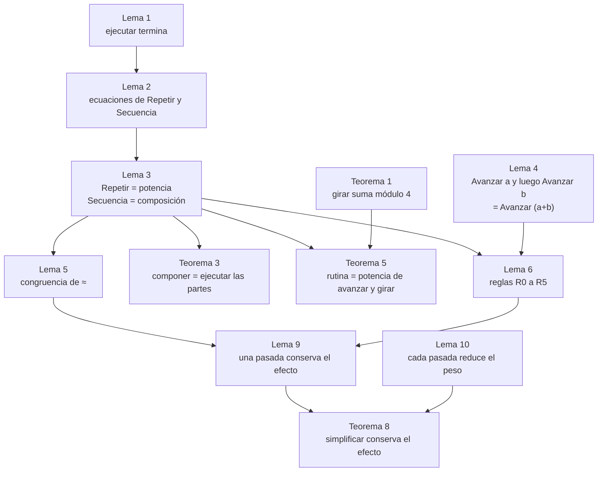
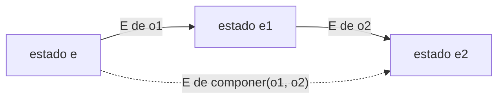
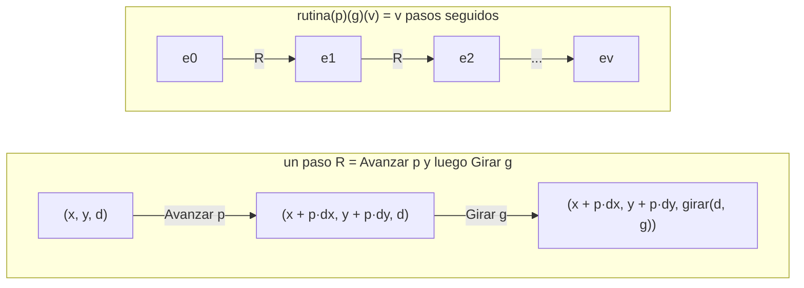
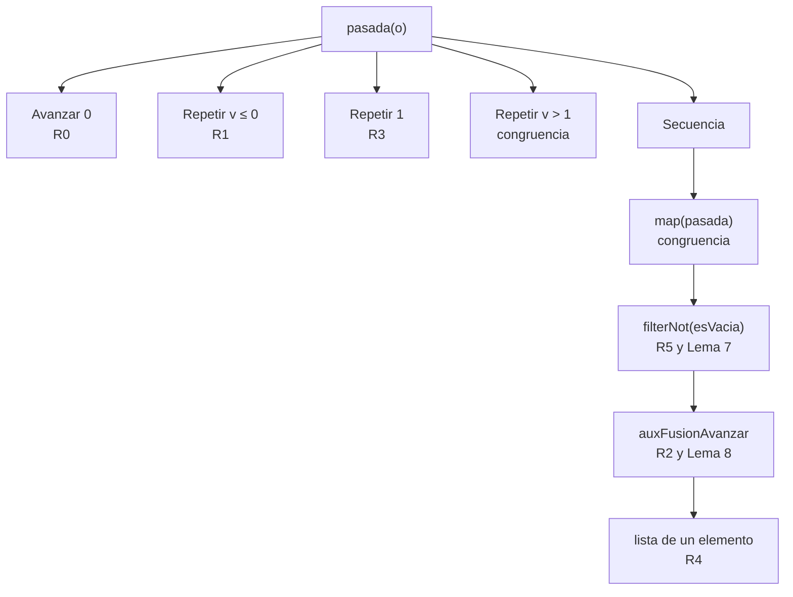
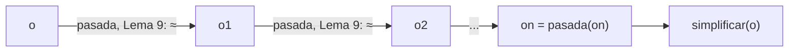
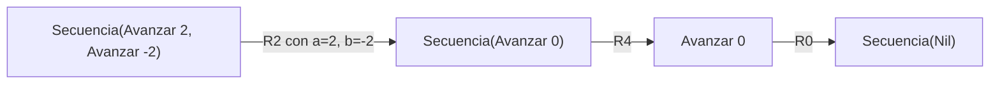

# Informe de corrección — Taller 2: robot en una cuadrícula

Este informe demuestra, con notación matemática, que las funciones del taller cumplen lo que prometen. Hay dos resultados centrales:

- **La rutina compuesta equivale a ejecutar sus partes** (secciones 3 y 4): `componer`, `Repetir` y `rutina` se reducen a componer funciones sobre estados.
- **`simplificar` no cambia el resultado** (sección 5): para toda orden $o$ y todo estado $e$, ejecutar $o$ y ejecutar `simplificar(o)` dejan el mismo estado. Se demuestra **regla por regla**.

Complementa a `informe_proceso.md`, que muestra las trazas de posiciones del robot.

## Contenido

0. [Notación y convenciones](#0-notación-y-convenciones)
1. [Punto 1: `girar`](#1-punto-1-girar)
2. [Punto 2: `ejecutar`](#2-punto-2-ejecutar)
3. [Composición: `componer`, `Repetir` y `rutina`](#3-composición-componer-repetir-y-rutina)
4. [Punto 4: `aplicarA` y `transformar`](#4-punto-4-aplicara-y-transformar)
5. [Punto 5: `simplificar`](#5-punto-5-simplificar)
6. [Punto 3: `cuantasBasicas` y `profundidad`](#6-punto-3-cuantasbasicas-y-profundidad)
7. [Pruebas y propiedades](#7-pruebas-y-propiedades)
8. [Alcance y precondiciones](#8-alcance-y-precondiciones)

---

## 0. Notación y convenciones

### Símbolos

| Símbolo | Significado |
|---|---|
| $\mathrm{Dir}=\lbrace\text{Norte},\text{Este},\text{Sur},\text{Oeste}\rbrace$ | Las cuatro direcciones |
| $e=(x,y,d)$ | Un estado: posición $(x,y)\in\mathbb{Z}^2$ y dirección $d\in\mathrm{Dir}$ |
| $\kappa:\mathrm{Dir}\to\mathbb{Z}_4$ | Numeración: $\kappa(\text{Norte})=0,\ \kappa(\text{Este})=1,\ \kappa(\text{Sur})=2,\ \kappa(\text{Oeste})=3$ |
| $\delta$ | $\delta(\text{Derecha})=+1$ y $\delta(\text{Izquierda})=-1$ |
| $\vec d(d)=(d_x,d_y)$ | Vector unitario de la dirección $d$ (ver abajo) |
| $\text{mover}(e,n)$ | Avanzar $n$ casillas desde $e$ (ver abajo) |
| $\mathcal{E}_o$ | La función $e\mapsto\texttt{ejecutar}(e,o)$, de estados en estados |
| $\mathcal{E}_{os}$ | Abreviatura de $\mathcal{E}_{\text{Secuencia}(os)}$ para una lista $os$ de órdenes |
| $g\circ f$ | Composición: $(g\circ f)(e)=g(f(e))$ |
| $f^k$ | Potencia: $f^0=\mathrm{id}$ y $f^{k+1}=f^k\circ f$ |
| $v^{+}$ | $\max(v,0)$ |
| $o\approx o'$ | Equivalencia de órdenes: $\mathcal{E}_o=\mathcal{E}_{o'}$ (son iguales como funciones, es decir, para todo estado dan el mismo resultado) |
| $\sigma(o)$ | Tamaño de $o$: número de nodos de su árbol |
| $[o_1,\dots,o_k]$ y $\mathbin{+\!\!+}$ | Lista de órdenes y concatenación de listas |

Vectores unitarios y movimiento:

$$
\vec d(\text{Norte})=(0,1),\quad
\vec d(\text{Este})=(1,0),\quad
\vec d(\text{Sur})=(0,-1),\quad
\vec d(\text{Oeste})=(-1,0)
$$

$$\text{mover}\big((x,y,d),n\big)=\big(x+n\,d_x,\ y+n\,d_y,\ d\big)$$

Esto coincide con el código: hacia el Norte suma $n$ a $y$, hacia el Sur la resta, hacia el Este suma a $x$ y hacia el Oeste resta.

### La relación $\approx$

Como $o\approx o'$ significa igualdad de funciones, es una **relación de equivalencia** (reflexiva, simétrica y transitiva) sobre las órdenes. Es la herramienta central del informe: *simplificar es correcto* significa $\texttt{simplificar}(o)\approx o$ para toda orden $o$.

### Ecuaciones de `ejecutar` (tal como las define el código)

$$
\begin{aligned}
&\text{(E1)}\quad \texttt{ejecutar}(e,\text{Avanzar}(n))=\text{mover}(e,n)\\
&\text{(E2)}\quad \texttt{ejecutar}((x,y,d),\text{Girar}(s))=(x,\ y,\ \texttt{girar}(d,s))\\
&\text{(E3)}\quad \texttt{ejecutar}(e,\text{Repetir}(v,o))=
\begin{cases}
e & \text{si } v\le 0\\
\texttt{ejecutar}\big(\texttt{ejecutar}(e,o),\ \text{Repetir}(v-1,o)\big) & \text{si } v>0
\end{cases}\\
&\text{(E4)}\quad \texttt{ejecutar}(e,\text{Secuencia}(os))=\texttt{os.foldLeft(e)(ejecutar)}
\end{aligned}
$$

### Mapa de la argumentación

---

## 1. Punto 1: `girar`

### Especificación

Girar noventa grados hacia la derecha es avanzar un cuarto de vuelta en el sentido horario Norte → Este → Sur → Oeste; hacia la izquierda es lo contrario. Con la numeración $\kappa$, eso se escribe:

$$\kappa\big(\texttt{girar}(d,s)\big)=\big(\kappa(d)+\delta(s)\big)\bmod 4$$

### Teorema 1 (corrección de `girar`)

Para todo $d\in\mathrm{Dir}$ y todo sentido $s$, `girar(d, s)` cumple la fórmula anterior.

**Demostración.** El `match` de `girar` tiene un caso por cada una de las $4\times 2=8$ parejas, así que basta comprobar los ocho:

| Caso | $d$ | $s$ | Resultado del código | $\kappa(d)$ | $\delta(s)$ | $(\kappa(d)+\delta(s))\bmod 4$ | $\kappa$(resultado) |
|---|---|---|---|---|---|---|---|
| 1 | Norte | Derecha | Este | 0 | $+1$ | 1 | 1 |
| 2 | Norte | Izquierda | Oeste | 0 | $-1$ | 3 | 3 |
| 3 | Oeste | Derecha | Norte | 3 | $+1$ | 0 | 0 |
| 4 | Oeste | Izquierda | Sur | 3 | $-1$ | 2 | 2 |
| 5 | Sur | Izquierda | Este | 2 | $-1$ | 1 | 1 |
| 6 | Sur | Derecha | Oeste | 2 | $+1$ | 3 | 3 |
| 7 | Este | Derecha | Sur | 1 | $+1$ | 2 | 2 |
| 8 | Este | Izquierda | Norte | 1 | $-1$ | 0 | 0 |

Las dos últimas columnas coinciden en las ocho filas. $\blacksquare$

### Corolario 1 (propiedades de los giros)

1. **Los giros se suman:** $\kappa\big(\texttt{girar}(\texttt{girar}(d,s_1),s_2)\big)=\big(\kappa(d)+\delta(s_1)+\delta(s_2)\big)\bmod 4$.
2. **Un giro y su contrario se cancelan:** $\texttt{girar}(\texttt{girar}(d,s),s')=d$ si $\delta(s)+\delta(s')=0$.
3. **Cuatro giros al mismo lado devuelven la dirección original:** como $4\,\delta(s)\equiv 0 \pmod 4$.

**Demostración.** (1) es aplicar el Teorema 1 dos veces y usar $(a\bmod 4+b)\bmod 4=(a+b)\bmod 4$. (2) y (3) son casos de (1) con sumas $0$ y $\pm 4$, ambas congruentes con $0$ módulo 4; como $\kappa$ es una biyección, $\kappa$ igual implica dirección igual. $\blacksquare$

---

## 2. Punto 2: `ejecutar`

### Especificación

Lo que el enunciado pide de `ejecutar` es:

$$
\begin{aligned}
\mathcal{E}_{\text{Avanzar}(n)}&=\text{mover}(\cdot,n)\\
\mathcal{E}_{\text{Girar}(s)}(x,y,d)&=(x,y,\texttt{girar}(d,s))\\
\mathcal{E}_{\text{Repetir}(v,o)}&=\mathcal{E}_o^{\,v^{+}}\qquad\text{(repetir } v \text{ veces; con } v\le 0 \text{ no hace nada)}\\
\mathcal{E}_{\text{Secuencia}([o_1,\dots,o_k])}&=\mathcal{E}_{o_k}\circ\cdots\circ\mathcal{E}_{o_1}\qquad\text{(una orden tras otra, en orden)}
\end{aligned}
$$

### Lema 1 (terminación de `ejecutar`)

`ejecutar(e, o)` termina para todo estado $e$ y toda orden finita $o$.

**Demostración.** Se define el tamaño $\sigma$: $\sigma(\text{Avanzar}(n))=\sigma(\text{Girar}(s))=1$, $\sigma(\text{Repetir}(v,o))=1+\sigma(o)$ y $\sigma(\text{Secuencia}(os))=1+\sum_i\sigma(o_i)$. A cada orden se le asigna la clave $\tau(o)=(\sigma(o),\,v^{+})$ si $o=\text{Repetir}(v,\_)$, y $\tau(o)=(\sigma(o),0)$ en otro caso. Las claves se comparan en orden lexicográfico, que es un orden bien fundado en $\mathbb{N}\times\mathbb{N}$.

Cada llamada recursiva de `ejecutar` es sobre una orden de clave estrictamente menor:

- `Avanzar` y `Girar` no hacen llamadas recursivas.
- En `Secuencia`, el `foldLeft` llama a `ejecutar` sobre cada $o_i$, con $\sigma(o_i)<\sigma(\text{Secuencia}(os))$.
- En `Repetir(v, o)` con $v>0$: la llamada interna `ejecutar(e, o)` tiene $\sigma(o)<\sigma(\text{Repetir}(v,o))$; la llamada externa sobre `Repetir(v-1, o)` tiene el mismo $\sigma$ y segunda componente $(v-1)^{+}=v-1<v=v^{+}$. $\blacksquare$

### Lema 2 (ecuaciones funcionales)

Para todo $o$, $os$ y $v$:

$$
\begin{aligned}
\text{(S0)}\quad&\mathcal{E}_{\text{Secuencia}(\text{Nil})}=\mathrm{id}\\
\text{(S1)}\quad&\mathcal{E}_{\text{Secuencia}(o::os)}=\mathcal{E}_{os}\circ\mathcal{E}_{o}\\
\text{(R0)}\quad&v\le 0\ \Rightarrow\ \mathcal{E}_{\text{Repetir}(v,o)}=\mathrm{id}\\
\text{(R1)}\quad&v>0\ \Rightarrow\ \mathcal{E}_{\text{Repetir}(v,o)}=\mathcal{E}_{\text{Repetir}(v-1,o)}\circ\mathcal{E}_{o}
\end{aligned}
$$

**Demostración.** (S0) y (S1) son la definición de `foldLeft`: `foldLeft(z)(Nil) = z` y `foldLeft(z)(h :: t) = foldLeft(f(z, h))(t)`. (R0) y (R1) son los dos casos de (E3), leídos como igualdades entre funciones de $e$. $\blacksquare$

### Lema 3 (`Repetir` es una potencia y `Secuencia` es una composición)

1. $\mathcal{E}_{\text{Repetir}(v,o)}=\mathcal{E}_o^{\,v^{+}}$.
2. $\mathcal{E}_{\text{Secuencia}([o_1,\dots,o_k])}=\mathcal{E}_{o_k}\circ\cdots\circ\mathcal{E}_{o_1}$ (para $k=0$, la composición vacía es $\mathrm{id}$).
3. **Concatenación:** $\mathcal{E}_{os_1\mathbin{+\!\!+}os_2}=\mathcal{E}_{os_2}\circ\mathcal{E}_{os_1}$.

**Demostración.**

1. Por inducción sobre $v^{+}$. Si $v\le 0$: (R0) da $\mathrm{id}=\mathcal{E}_o^{0}$. Si $v>0$: por (R1) y la hipótesis para $v-1$, $\mathcal{E}_{\text{Repetir}(v,o)}=\mathcal{E}_o^{\,v-1}\circ\mathcal{E}_o=\mathcal{E}_o^{\,v}$.
2. Por inducción sobre $k$. Para $k=0$ es (S0). Para $k+1$, (S1) da $\mathcal{E}_{[o_1,\dots,o_{k+1}]}=\mathcal{E}_{[o_2,\dots,o_{k+1}]}\circ\mathcal{E}_{o_1}$, y por la hipótesis aplicada a la cola, $\mathcal{E}_{[o_2,\dots,o_{k+1}]}=\mathcal{E}_{o_{k+1}}\circ\cdots\circ\mathcal{E}_{o_2}$.
3. Es (2) aplicado a la lista concatenada, junto con la asociatividad de $\circ$. $\blacksquare$

### Lema 4 (propiedades de `Avanzar`)

1. $\mathcal{E}_{\text{Avanzar}(0)}=\mathrm{id}$.
2. $\mathcal{E}_{\text{Avanzar}(b)}\circ\mathcal{E}_{\text{Avanzar}(a)}=\mathcal{E}_{\text{Avanzar}(a+b)}$ para todos $a,b\in\mathbb{Z}$.
3. `Avanzar` no cambia la dirección.

**Demostración.** Sea $e=(x,y,d)$. Por (E1), $\text{mover}(e,a)=(x+a\,d_x,\ y+a\,d_y,\ d)$, lo que prueba (3). Aplicando de nuevo $\text{mover}$ con $b$ sobre ese estado:

$$\big(x+a\,d_x+b\,d_x,\ y+a\,d_y+b\,d_y,\ d\big)=\big(x+(a+b)\,d_x,\ y+(a+b)\,d_y,\ d\big)=\text{mover}(e,a+b)$$

por distributividad. Esto es (2). Con $a=0$ se obtiene $\text{mover}(e,0)=e$, que es (1). $\blacksquare$

### Lema 5 (congruencia de $\approx$)

1. Si $o\approx o'$, entonces $\text{Repetir}(v,o)\approx\text{Repetir}(v,o')$.
2. Si $o_i\approx o_i'$ para $i=1,\dots,k$, entonces $\text{Secuencia}([o_1,\dots,o_k])\approx\text{Secuencia}([o_1',\dots,o_k'])$.
3. **Sustitución en listas:** si $\mathcal{E}_{m}=\mathcal{E}_{m'}$ para dos listas $m$ y $m'$, entonces $\text{Secuencia}(os_1\mathbin{+\!\!+}m\mathbin{+\!\!+}os_2)\approx\text{Secuencia}(os_1\mathbin{+\!\!+}m'\mathbin{+\!\!+}os_2)$.

**Demostración.** (1) Por el Lema 3.1, $\mathcal{E}_{\text{Repetir}(v,o)}=\mathcal{E}_o^{\,v^{+}}=\mathcal{E}_{o'}^{\,v^{+}}=\mathcal{E}_{\text{Repetir}(v,o')}$. (2) Por el Lema 3.2 ambos lados son composiciones de las mismas funciones. (3) Por el Lema 3.3, $\mathcal{E}_{os_1\mathbin{+\!\!+}m\mathbin{+\!\!+}os_2}=\mathcal{E}_{os_2}\circ\mathcal{E}_{m}\circ\mathcal{E}_{os_1}$, y se cambia $\mathcal{E}_m$ por $\mathcal{E}_{m'}$. $\blacksquare$

### Teorema 2 (corrección de `ejecutar`)

`ejecutar` termina y satisface la especificación de esta sección.

**Demostración.** La terminación es el Lema 1. Para `Avanzar` y `Girar`, la especificación es literalmente (E1) y (E2). Para `Repetir` y `Secuencia`, son los puntos 1 y 2 del Lema 3. $\blacksquare$

---

## 3. Composición: `componer`, `Repetir` y `rutina`

Esta sección demuestra que **una orden compuesta equivale a ejecutar sus partes**, una tras otra.

### Teorema 3 (`componer` equivale a ejecutar las dos partes)

Para toda pareja de órdenes $o_1,o_2$ y todo estado $e$:

$$\texttt{ejecutar}\big(e,\ \texttt{componer}(o_1,o_2)\big)=\texttt{ejecutar}\big(\texttt{ejecutar}(e,o_1),\ o_2\big)$$

es decir, $\mathcal{E}_{\texttt{componer}(o_1,o_2)}=\mathcal{E}_{o_2}\circ\mathcal{E}_{o_1}$.

**Demostración.** `componer(o1, o2)` es `Secuencia(List(o1, o2))`. Por el Lema 3.2 con $k=2$, $\mathcal{E}_{[o_1,o_2]}=\mathcal{E}_{o_2}\circ\mathcal{E}_{o_1}$. $\blacksquare$

### Corolario 3 (consecuencias de la composición)

1. **Asociatividad:** $\texttt{componer}(\texttt{componer}(a,b),c)\approx\texttt{componer}(a,\texttt{componer}(b,c))$, aunque los árboles sean distintos.
2. **Neutro:** $\texttt{componer}(\text{Secuencia}(\text{Nil}),o)\approx o\approx\texttt{componer}(o,\text{Secuencia}(\text{Nil}))$.
3. **No conmutativa:** $\texttt{componer}(o_1,o_2)\not\approx\texttt{componer}(o_2,o_1)$ en general.

**Demostración.**

1. Por el Teorema 3 aplicado dos veces, ambos lados valen $\mathcal{E}_c\circ\mathcal{E}_b\circ\mathcal{E}_a$.
2. Por el Teorema 3 y (S0): $\mathcal{E}_o\circ\mathrm{id}=\mathcal{E}_o=\mathrm{id}\circ\mathcal{E}_o$.
3. Contraejemplo desde $\text{inicial}=(0,0,\text{Norte})$ con $o_1=\text{Avanzar}(2)$ y $o_2=\text{Girar}(\text{Derecha})$:
   $$\mathcal{E}_{o_2}\big(\mathcal{E}_{o_1}(\text{inicial})\big)=\mathcal{E}_{o_2}(0,2,\text{Norte})=(0,2,\text{Este})$$
   $$\mathcal{E}_{o_1}\big(\mathcal{E}_{o_2}(\text{inicial})\big)=\mathcal{E}_{o_1}(0,0,\text{Este})=(2,0,\text{Este})$$
   Los resultados son distintos. $\blacksquare$

### Teorema 4 (`Repetir` equivale a ejecutar sus copias en secuencia)

Para todo $v\in\mathbb{Z}$:

$$\text{Repetir}(v,o)\ \approx\ \text{Secuencia}\big(\underbrace{[o,\dots,o]}_{v^{+}\text{ copias}}\big)$$

**Demostración.** Por el Lema 3.2, el lado derecho vale $\mathcal{E}_o\circ\cdots\circ\mathcal{E}_o=\mathcal{E}_o^{\,v^{+}}$ ($v^{+}$ factores), y por el Lema 3.1 eso es $\mathcal{E}_{\text{Repetir}(v,o)}$. $\blacksquare$

### Teorema 5 (`rutina` equivale a ejecutar "avanzar y girar" $v$ veces)

Sea $R_{p,g}(x,y,d)=\big(x+p\,d_x,\ y+p\,d_y,\ \texttt{girar}(d,g)\big)$ el efecto de un paso (avanzar $p$ y girar hacia $g$). Entonces, para todo $p\in\mathbb{Z}$, sentido $g$ y $v\in\mathbb{Z}$:

$$\mathcal{E}_{\texttt{rutina}(p)(g)(v)}=\big(\mathcal{E}_{\text{Girar}(g)}\circ\mathcal{E}_{\text{Avanzar}(p)}\big)^{v^{+}}=R_{p,g}^{\,v^{+}}$$

**Demostración.** Por el código, $\texttt{rutina}(p)(g)(v)=\text{Repetir}\big(v,\ \text{Secuencia}([\text{Avanzar}(p),\text{Girar}(g)])\big)$. Por el Lema 3.1, $\mathcal{E}=\mathcal{E}_{S}^{\,v^{+}}$ con $S$ la secuencia interna. Por el Lema 3.2, $\mathcal{E}_S=\mathcal{E}_{\text{Girar}(g)}\circ\mathcal{E}_{\text{Avanzar}(p)}$. Evaluando sobre $(x,y,d)$:

$$(x,y,d)\ \xrightarrow{\text{Avanzar}(p)}\ (x+p\,d_x,\ y+p\,d_y,\ d)\ \xrightarrow{\text{Girar}(g)}\ (x+p\,d_x,\ y+p\,d_y,\ \texttt{girar}(d,g))$$

que es $R_{p,g}(x,y,d)$. $\blacksquare$

La currificación no cambia el resultado: `rutina(p)(g)` es la función $v\mapsto\texttt{rutina}(p)(g)(v)$, de modo que aplicarla a $v$ da lo mismo que llamar `rutina(p)(g)(v)`.

### Corolario 5 (fórmula cerrada y el cuadrado)

Sea $e_0=(x_0,y_0,d_0)$ y $\delta=\delta(g)$. Sea $e_j=R_{p,g}^{\,j}(e_0)=(x_j,y_j,d_j)$ el estado tras $j$ pasos.

1. **Fórmula cerrada:** $\kappa(d_j)=(\kappa(d_0)+j\,\delta)\bmod 4$ y
   $$(x_j,y_j)=(x_0,y_0)+p\sum_{i=0}^{j-1}\vec d(d_i)$$
2. **Cada cuatro pasos se vuelve al punto de partida:** $R_{p,g}^{\,4}=\mathrm{id}$ y, por tanto, $\mathcal{E}_{\texttt{rutina}(p)(g)(4k)}=\mathrm{id}$ para todo $k\ge 0$ y todos $p$ y $g$.

**Demostración.**

1. Por inducción sobre $j$. Para $j=0$ es trivial. Para $j+1$: $e_{j+1}=R_{p,g}(e_j)$ suma $p\,\vec d(d_j)$ a la posición, y por el Teorema 1, $\kappa(d_{j+1})=(\kappa(d_j)+\delta)\bmod 4=(\kappa(d_0)+(j+1)\delta)\bmod 4$.
2. Los valores $\kappa(d_i)=(\kappa(d_0)+i\,\delta)\bmod 4$ para $i=0,1,2,3$ son distintos entre sí, porque $\delta=\pm1$ y $0<\lvert i-i'\rvert<4$ implica $(i-i')\,\delta\not\equiv 0\pmod 4$. Luego los cuatro pasos recorren **las cuatro direcciones, cada una una vez**, y
   $$\sum_{i=0}^{3}\vec d(d_i)=(0,1)+(1,0)+(0,-1)+(-1,0)=(0,0)$$
   Por (1), $(x_4,y_4)=(x_0,y_0)$ y $\kappa(d_4)=\kappa(d_0)+4\,\delta\equiv\kappa(d_0)$. Entonces $R_{p,g}^{\,4}=\mathrm{id}$ y $R_{p,g}^{\,4k}=(R_{p,g}^{\,4})^k=\mathrm{id}$. $\blacksquare$

**Ejemplo (el cuadrado).** Para $\texttt{rutina}(1)(\text{Derecha})(4)$ desde $\text{inicial}$: $\kappa(d_0)=0$ y $\delta=+1$, así que las direcciones son Norte, Este, Sur, Oeste y las posiciones son $(0,1)$, $(1,1)$, $(1,0)$ y $(0,0)$, de vuelta al origen y con $\kappa(d_4)=4\bmod 4=0$, es decir, mirando al Norte. Eso coincide con la traza del informe de proceso.

**Ejemplo (un paso).** $\texttt{rutina}(2)(\text{Izquierda})(1)$ desde $\text{inicial}$: $R_{2,\text{Izquierda}}(0,0,\text{Norte})=(0,2,\texttt{girar}(\text{Norte},\text{Izquierda}))=(0,2,\text{Oeste})$.

---

## 4. Punto 4: `aplicarA` y `transformar`

### Teorema 6 (`aplicarA`)

Para toda lista de estados $es=[e_1,\dots,e_m]$ y toda orden $o$: $\texttt{aplicarA}(es,o)=[\mathcal{E}_o(e_1),\dots,\mathcal{E}_o(e_m)]$. En consecuencia:

1. El resultado tiene la **misma longitud** que $es$.
2. El $i$-ésimo resultado depende **sólo** de $e_i$: los robots no se afectan entre sí.
3. **Compatibilidad con la composición:** $\texttt{aplicarA}\big(\texttt{aplicarA}(es,o_1),o_2\big)=\texttt{aplicarA}\big(es,\texttt{componer}(o_1,o_2)\big)$.

**Demostración.** La fórmula es la definición de `map`. (1) y (2) se leen directamente de ella. Para (3): aplicar `map` con $\mathcal{E}_{o_1}$ y luego con $\mathcal{E}_{o_2}$ da, en cada posición, $\mathcal{E}_{o_2}(\mathcal{E}_{o_1}(e_i))=(\mathcal{E}_{o_2}\circ\mathcal{E}_{o_1})(e_i)$, y por el Teorema 3 eso es $\mathcal{E}_{\texttt{componer}(o_1,o_2)}(e_i)$. $\blacksquare$

### Teorema 7 (`transformar`)

Con `transformar` definida por:

$$
\begin{aligned}
\texttt{transformar}(\text{Avanzar}(n),f)&=f(\text{Avanzar}(n))\\
\texttt{transformar}(\text{Girar}(s),f)&=f(\text{Girar}(s))\\
\texttt{transformar}(\text{Repetir}(v,o),f)&=\text{Repetir}\big(v,\ \texttt{transformar}(o,f)\big)\\
\texttt{transformar}(\text{Secuencia}(os),f)&=\text{Secuencia}\big(os.\texttt{map}(\texttt{transformar}(\_,f))\big)
\end{aligned}
$$

se cumple:

1. **Identidad:** $\texttt{transformar}(o,\mathrm{id})=o$ (igualdad de árboles).
2. **Compatibilidad con $\approx$:** si $f(b)\approx g(b)$ para toda orden básica $b$, entonces $\texttt{transformar}(o,f)\approx\texttt{transformar}(o,g)$ para toda $o$. En particular, si $f(b)\approx b$ para toda básica $b$, entonces $\texttt{transformar}(o,f)\approx o$.

**Demostración.** Por inducción estructural sobre $o$.

*Básicas:* (1) $\mathrm{id}(b)=b$; (2) es la hipótesis.

*`Repetir(v, o')`:* con la hipótesis de inducción $\texttt{transformar}(o',f)\approx\texttt{transformar}(o',g)$, el Lema 5.1 da la equivalencia de los `Repetir` correspondientes. En (1), `Repetir(v, o')` queda igual.

*`Secuencia(os)`:* `map` conserva la longitud y, por hipótesis de inducción, cada elemento transformado con $f$ es equivalente al transformado con $g$; el Lema 5.2 da la equivalencia. En (1), `map` con la identidad deja la lista igual. $\blacksquare$

---

## 5. Punto 5: `simplificar`

### Enunciado del resultado

$$\boxed{\ \forall o\ \forall e:\quad \texttt{ejecutar}\big(e,\ \texttt{simplificar}(o)\big)=\texttt{ejecutar}(e,\ o)\ }
\qquad\text{es decir}\qquad \texttt{simplificar}(o)\approx o$$

### Estructura del código

`simplificar` está formada por:

- `esVacia`: $\text{Secuencia}(\text{Nil})$, $\text{Avanzar}(0)$ y $\text{Repetir}(v,\_)$ con $v\le 0$ son *vacías*; las demás no.
- `auxFusionAvanzar`: reemplaza dos `Avanzar` seguidos por uno con la suma, hasta que no haya pares.
- `auxSimplicarUnaVez`, que llamaremos la **pasada**: aplica las reglas bajando por el árbol.
- `auxPuntoFijo`: repite la pasada hasta que la orden deje de cambiar.

### Lema 6 (cada regla conserva el efecto, regla por regla)

Las reglas del código, numeradas según los comentarios, son equivalencias de órdenes:

| Regla | Enunciado formal | Demostración |
|---|---|---|
| **R0** | $\text{Avanzar}(0)\approx\text{Secuencia}(\text{Nil})$ | Por el Lema 4.1, $\mathcal{E}_{\text{Avanzar}(0)}=\mathrm{id}$, y por (S0), $\mathcal{E}_{\text{Secuencia}(\text{Nil})}=\mathrm{id}$. |
| **R1** | $v\le 0\ \Rightarrow\ \text{Repetir}(v,o)\approx\text{Secuencia}(\text{Nil})$ | Por (R0), $\mathcal{E}_{\text{Repetir}(v,o)}=\mathrm{id}$, igual que $\mathcal{E}_{\text{Secuencia}(\text{Nil})}$ por (S0). |
| **R2** | $\text{Secuencia}(os_1\mathbin{+\!\!+}[\text{Avanzar}(a),\text{Avanzar}(b)]\mathbin{+\!\!+}os_2)\approx\text{Secuencia}(os_1\mathbin{+\!\!+}[\text{Avanzar}(a+b)]\mathbin{+\!\!+}os_2)$ | Por el Lema 3.2, $\mathcal{E}_{[\text{Avanzar}(a),\text{Avanzar}(b)]}=\mathcal{E}_{\text{Avanzar}(b)}\circ\mathcal{E}_{\text{Avanzar}(a)}$, y por el Lema 4.2 eso es $\mathcal{E}_{\text{Avanzar}(a+b)}=\mathcal{E}_{[\text{Avanzar}(a+b)]}$. Se concluye con el Lema 5.3. |
| **R3** | $\text{Repetir}(1,o)\approx o$ | Por el Lema 3.1, $\mathcal{E}_{\text{Repetir}(1,o)}=\mathcal{E}_o^{\,1}=\mathcal{E}_o$. |
| **R4** | $\text{Secuencia}([o])\approx o$ | Por (S1) y (S0), $\mathcal{E}_{[o]}=\mathcal{E}_{\text{Nil}}\circ\mathcal{E}_o=\mathrm{id}\circ\mathcal{E}_o=\mathcal{E}_o$. |
| **R5** | $\mathcal{E}_o=\mathrm{id}\ \Rightarrow\ \text{Secuencia}(os_1\mathbin{+\!\!+}[o]\mathbin{+\!\!+}os_2)\approx\text{Secuencia}(os_1\mathbin{+\!\!+}os_2)$ | Por R4, $\mathcal{E}_{[o]}=\mathcal{E}_o=\mathrm{id}=\mathcal{E}_{\text{Nil}}$; se concluye con el Lema 5.3 con $m=[o]$ y $m'=\text{Nil}$. $\blacksquare$ |

### Lema 7 (las órdenes "vacías" no hacen nada)

Si $\texttt{esVacia}(o)=\text{true}$, entonces $\mathcal{E}_o=\mathrm{id}$.

**Demostración.** Hay tres casos. $o=\text{Secuencia}(\text{Nil})$: (S0). $o=\text{Avanzar}(0)$: Lema 4.1. $o=\text{Repetir}(v,\_)$ con $v\le0$: (R0). $\blacksquare$

Con este lema, `filterNot(esVacia)` es una aplicación repetida de la regla R5.

### Lema 8 (la fusión de avances conserva el efecto)

Para toda lista $os$: $\text{Secuencia}(\texttt{auxFusionAvanzar}(os))\approx\text{Secuencia}(os)$.

**Demostración.** Por inducción sobre la longitud de $os$.

- $os=\text{Nil}$: devuelve `Nil`; las dos secuencias son iguales.
- $os=\text{Avanzar}(n_1)::\text{Avanzar}(n_2)::r$: el código devuelve $\texttt{auxFusionAvanzar}(\text{Avanzar}(n_1+n_2)::r)$, una lista **una posición más corta**. Entonces
  $$\text{Secuencia}(os)\ \overset{\text{R2}}{\approx}\ \text{Secuencia}(\text{Avanzar}(n_1+n_2)::r)\ \overset{\text{HI}}{\approx}\ \text{Secuencia}\big(\texttt{auxFusionAvanzar}(\text{Avanzar}(n_1+n_2)::r)\big)$$
- $os=h::t$ (cualquier otro caso): devuelve $h::\texttt{auxFusionAvanzar}(t)$. Por hipótesis de inducción, $\mathcal{E}_{\texttt{auxFusionAvanzar}(t)}=\mathcal{E}_t$, y por (S1), $\mathcal{E}_{h::\texttt{auxFusionAvanzar}(t)}=\mathcal{E}_{\texttt{auxFusionAvanzar}(t)}\circ\mathcal{E}_h=\mathcal{E}_t\circ\mathcal{E}_h=\mathcal{E}_{h::t}$. $\blacksquare$

### Lema 9 (una pasada conserva el efecto)

Para toda orden $o$: $\texttt{auxSimplicarUnaVez}(o)\approx o$.

**Demostración.** Por inducción estructural sobre $o$. Sea $\text{pasada}$ la función `auxSimplicarUnaVez`.

| Caso de $o$ | Qué devuelve la pasada | Por qué $\text{pasada}(o)\approx o$ |
|---|---|---|
| $\text{Avanzar}(0)$ | $\text{Secuencia}(\text{Nil})$ | R0 |
| $\text{Avanzar}(n)$, $n\ne0$ | $\text{Avanzar}(n)$ | Es la misma orden (reflexividad) |
| $\text{Girar}(s)$ | $\text{Girar}(s)$ | Es la misma orden |
| $\text{Repetir}(v,o')$ con $v\le 0$ | $\text{Secuencia}(\text{Nil})$ | R1 |
| $\text{Repetir}(1,o')$ | $\text{pasada}(o')$ | Por hipótesis de inducción, $\text{pasada}(o')\approx o'$; y por R3, $o'\approx\text{Repetir}(1,o')$ |
| $\text{Repetir}(v,o')$ con $v>1$ | $\text{Repetir}(v,\text{pasada}(o'))$ | Por hipótesis de inducción, $\text{pasada}(o')\approx o'$; se concluye con el Lema 5.1 |
| $\text{Secuencia}(os)$ | Ver abajo | Ver abajo |

*Caso $\text{Secuencia}(os)$.* La pasada hace cuatro pasos, y cada uno conserva $\approx$:

1. **`map(pasada)`:** por hipótesis de inducción, $\text{pasada}(o_i)\approx o_i$ para cada elemento; el Lema 5.2 da $\text{Secuencia}(os.\texttt{map}(\text{pasada}))\approx\text{Secuencia}(os)$.
2. **`filterNot(esVacia)`:** cada elemento eliminado es vacío, así que por el Lema 7 es una función identidad; por R5 (aplicada una vez por elemento eliminado) la secuencia es equivalente.
3. **`auxFusionAvanzar`:** es equivalente por el Lema 8.
4. **El `match` final:** si la lista queda $\text{Nil}$, devuelve $\text{Secuencia}(\text{Nil})$ (la misma secuencia vacía); si queda $[u]$, devuelve $u$, y $u\approx\text{Secuencia}([u])$ por R4; si quedan varias, devuelve $\text{Secuencia}(varias)$, la misma orden.

Por transitividad de $\approx$, $\text{pasada}(\text{Secuencia}(os))\approx\text{Secuencia}(os)$. $\blacksquare$

### Lema 10 (cada pasada reduce el peso o no cambia nada)

Se define el **peso** de una orden:

$$
\begin{aligned}
\mu(\text{Avanzar}(0))&=3,\qquad \mu(\text{Avanzar}(n))=2\ (n\ne0),\qquad \mu(\text{Girar}(s))=1\\
\mu(\text{Repetir}(v,o))&=1+\mu(o),\qquad \mu(\text{Secuencia}(os))=1+\sum_i\mu(o_i)
\end{aligned}
$$

Para toda orden $o$: $\mu(\text{pasada}(o))\le\mu(o)$, y si $\text{pasada}(o)\ne o$, entonces $\mu(\text{pasada}(o))<\mu(o)$.

**Demostración.** Por inducción estructural sobre $o$.

- $\text{Avanzar}(0)\mapsto\text{Secuencia}(\text{Nil})$: el peso baja de 3 a 1 (estricto). $\text{Avanzar}(n)$ con $n\ne0$ y $\text{Girar}$ no cambian.
- $\text{Repetir}(v,o')$ con $v\le 0$: pasa a $\text{Secuencia}(\text{Nil})$, de peso $1<1+\mu(o')$ (estricto).
- $\text{Repetir}(1,o')$: pasa a $\text{pasada}(o')$, de peso $\le\mu(o')<1+\mu(o')$ (estricto).
- $\text{Repetir}(v,o')$ con $v>1$: pasa a $\text{Repetir}(v,\text{pasada}(o'))$; el peso no sube, y si cambia, es porque $\text{pasada}(o')\ne o'$, y por hipótesis de inducción baja.
- $\text{Secuencia}(os)$: `map(pasada)` no sube el peso (hipótesis de inducción). `filterNot` quita elementos de peso $\ge1$ (baja estrictamente). La fusión reemplaza dos `Avanzar` (peso $\ge 2+2=4$) por uno (peso $\le 3$) (baja estrictamente). Quitar el envoltorio de una lista de un elemento baja el peso en 1. Si el resultado es distinto de la entrada, alguno de estos pasos (o un elemento con $\text{pasada}(o_i)\ne o_i$) ocurrió, y baja estrictamente; si ninguno ocurre, el resultado es la misma secuencia. $\blacksquare$

### Teorema 8 (corrección de `simplificar`)

Para toda orden $o$, `simplificar(o)` termina y

$$\texttt{simplificar}(o)\approx o,\qquad\text{es decir}\qquad \forall e:\ \texttt{ejecutar}\big(e,\texttt{simplificar}(o)\big)=\texttt{ejecutar}(e,o)$$

**Demostración.** `simplificar(o)` es `auxPuntoFijo(o)`. Se prueba, por inducción sobre el peso $\mu(\text{actual})$, que $\texttt{auxPuntoFijo}(\text{actual})$ termina y es $\approx\text{actual}$. Sea $\text{next}=\text{pasada}(\text{actual})$:

- Si $\text{next}=\text{actual}$, el código devuelve $\text{actual}$, que es equivalente a sí mismo.
- Si $\text{next}\ne\text{actual}$, por el Lema 10, $\mu(\text{next})<\mu(\text{actual})$, así que se puede aplicar la hipótesis de inducción: $\texttt{auxPuntoFijo}(\text{next})\approx\text{next}$. Y por el Lema 9, $\text{next}\approx\text{actual}$. Por transitividad, $\texttt{auxPuntoFijo}(\text{actual})\approx\text{actual}$.

Como $\mu$ toma valores en $\mathbb{N}$, la recursión termina. $\blacksquare$

La cadena de equivalencias que recorre el punto fijo es:

### Corolario 8 (idempotencia)

$\texttt{simplificar}(\texttt{simplificar}(o))=\texttt{simplificar}(o)$.

**Demostración.** Sea $r=\texttt{simplificar}(o)$. La recursión termina cuando $\text{pasada}(r)=r$, luego $\texttt{auxPuntoFijo}(r)$ devuelve $r$ en su primera llamada. $\blacksquare$

### Ejemplos del razonamiento regla por regla

**Ejemplo A.** $o=\text{Secuencia}([\text{Avanzar}(2),\text{Avanzar}(-2)])$:

Tres reglas, tres pasadas: coincide con la ejecución del informe de proceso. Se comprueba: $\mathcal{E}_{\text{Avanzar}(-2)}\big(\mathcal{E}_{\text{Avanzar}(2)}(0,0,\text{Norte})\big)=\mathcal{E}_{\text{Avanzar}(-2)}(0,2,\text{Norte})=(0,0,\text{Norte})$, que es lo que hace $\text{Secuencia}(\text{Nil})$.

**Ejemplo B.** $o=\text{Repetir}\big(3,\ \text{Secuencia}([\text{Repetir}(1,\text{Avanzar}(2)),\ \text{Girar}(\text{Izquierda})])\big)$:

1. $\text{Repetir}(1,\text{Avanzar}(2))\approx\text{Avanzar}(2)$ por R3.
2. Por el Lema 5.2, $\text{Secuencia}([\text{Repetir}(1,\text{Avanzar}(2)),\text{Girar}(\text{Izquierda})])\approx\text{Secuencia}([\text{Avanzar}(2),\text{Girar}(\text{Izquierda})])$.
3. Por el Lema 5.1, $o\approx\text{Repetir}\big(3,\text{Secuencia}([\text{Avanzar}(2),\text{Girar}(\text{Izquierda})])\big)$.

Esta última es $\texttt{rutina}(2)(\text{Izquierda})(3)$, así que por el Teorema 5 y el Corolario 5.1: $\kappa(d_0)=0$ y $\delta=-1$ dan las direcciones Norte, Oeste y Sur, con posición $2\cdot\big((0,1)+(-1,0)+(0,-1)\big)=(-2,0)$ y dirección $\kappa=(0-3)\bmod 4=1$ (Este). El estado final es $(-2,0,\text{Este})$, igual que en el informe de proceso.

---

## 6. Punto 3: `cuantasBasicas` y `profundidad`

### Teorema 9 (`cuantasBasicas` cuenta las órdenes básicas ejecutadas)

Se define la lista de básicas que se ejecutan, `aplanar`:

$$
\begin{aligned}
\text{aplanar}(\text{Avanzar}(n))&=[\text{Avanzar}(n)],\qquad \text{aplanar}(\text{Girar}(s))=[\text{Girar}(s)]\\
\text{aplanar}(\text{Repetir}(v,o))&=\underbrace{\text{aplanar}(o)\mathbin{+\!\!+}\cdots\mathbin{+\!\!+}\text{aplanar}(o)}_{v^{+}\text{ veces}}\\
\text{aplanar}(\text{Secuencia}([o_1,\dots,o_k]))&=\text{aplanar}(o_1)\mathbin{+\!\!+}\cdots\mathbin{+\!\!+}\text{aplanar}(o_k)
\end{aligned}
$$

Entonces, para toda orden $o$:

1. $\texttt{cuantasBasicas}(o)=\text{longitud}\big(\text{aplanar}(o)\big)$.
2. $o\approx\text{Secuencia}\big(\text{aplanar}(o)\big)$.

**Demostración.** Por inducción estructural sobre $o$.

(1) *Básicas:* ambos lados valen 1. *Repetir:* el código da $0$ si $v\le0$ y $v\cdot B(o')$ si no, es decir $v^{+}\cdot B(o')$; por hipótesis de inducción $B(o')$ es la longitud de $\text{aplanar}(o')$ y $v^{+}$ copias suman $v^{+}\cdot B(o')$. *Secuencia:* el código suma, y la longitud de una concatenación es la suma de las longitudes.

(2) *Básicas:* $b\approx\text{Secuencia}([b])$ por R4. *Repetir:* $\mathcal{E}_{\text{Repetir}(v,o')}=\mathcal{E}_{o'}^{\,v^{+}}=\mathcal{E}_{\text{aplanar}(o')}^{\,v^{+}}$ por hipótesis de inducción, y por el Lema 3.3 eso es $\mathcal{E}$ de la concatenación de $v^{+}$ copias. *Secuencia:* $\mathcal{E}=\mathcal{E}_{o_k}\circ\cdots\circ\mathcal{E}_{o_1}=\mathcal{E}_{\text{aplanar}(o_k)}\circ\cdots\circ\mathcal{E}_{\text{aplanar}(o_1)}=\mathcal{E}_{\text{aplanar}(o_1)\mathbin{+\!\!+}\cdots\mathbin{+\!\!+}\text{aplanar}(o_k)}$. $\blacksquare$

**Consecuencia.** El número de filas de la traza de posiciones del robot (una por orden básica ejecutada) es exactamente `cuantasBasicas`. Por ejemplo, el cuadrado tiene $B=4\cdot2=8$ y su traza tiene 8 pasos.

### Proposición 10 (`profundidad`)

Para toda orden $o$: $1\le\texttt{profundidad}(o)\le\sigma(o)$, y $\texttt{profundidad}(\text{Repetir}(v,o))=1+\texttt{profundidad}(o)$ para todo $v$.

**Demostración.** Por inducción estructural. *Básicas:* $1\le1\le1$. *Repetir:* $P=1+P(o')$, y $1\le 1+P(o')\le 1+\sigma(o')=\sigma$. *Secuencia vacía:* $P=1\le\sigma=1$. *Secuencia no vacía:* $P=1+\max_iP(o_i)\ge1$, y $\max_iP(o_i)\le\max_i\sigma(o_i)\le\sum_i\sigma(o_i)$, luego $P\le1+\sum_i\sigma(o_i)=\sigma$. La igualdad para `Repetir` es la definición: `profundidad` no mira $v$. $\blacksquare$

---

## 7. Pruebas y propiedades

Cada grupo de pruebas del archivo de tests comprueba una propiedad demostrada arriba:

| Propiedad demostrada | Pruebas que la ejercitan |
|---|---|
| Teorema 1 y Corolario 1 (`girar`) | las ocho combinaciones de `girar`; cuatro giros a un lado vuelven al origen; un giro y su contrario se cancelan |
| Teorema 2 y Lema 4 (`ejecutar`) | avanzar en las cuatro direcciones; `Avanzar(0)` y `Avanzar(-2)`; `Repetir` con $v\le0$; `Secuencia(Nil)`; `Repetir` anidado multiplica los avances |
| Teorema 3 y Corolario 3 (`componer`) | ejecutar la compuesta es ejecutar una y luego la otra; dos avances; giro y avance; secuencia vacía como neutro; el orden importa |
| Teorema 4 y Teorema 5 (`Repetir` y `rutina`) | el cuadrado vuelve al origen (también con giro a la izquierda); `rutina(1)(Derecha)(4) == cuadrado`; cero repeticiones; pasos negativos; una repetición |
| Teorema 6 (`aplicarA`) | lista vacía; un solo estado; la longitud se conserva; no modifica la lista original; varios estados con secuencia y con `Repetir` |
| Teorema 7 (`transformar`) | la identidad no cambia nada; duplicar avances; invertir giros; `f` sólo se aplica a básicas; conserva el anidamiento |
| Lema 6 (R0 a R5) | dos avances se juntan; `Repetir(1, ...)`; `Avanzar(0)` desaparece; `Repetir(0, ...)`; avances que se cancelan; avances contiguos y separados; secuencia de un elemento |
| Teorema 8 | «simplificar: no cambia el resultado de ejecutar» (ocho órdenes por tres estados) |
| Corolario 8 | «simplificar: es idempotente» |
| Teorema 9 y Proposición 10 | las pruebas de `cuantasBasicas` (cuadrado = 8, `Repetir` multiplica, `Secuencia` suma) y de `profundidad` (básica = 1, `Repetir` suma un nivel, manda la rama más honda) |

---

## 8. Alcance y precondiciones

1. **Órdenes finitas.** Todos los argumentos por inducción estructural suponen que `Orden` es un árbol finito, como lo son los valores construidos con `case class`.
2. **Aritmética de `Int`.** Los Lemas 4.2 y R2 usan que $x+a\,d_x+b\,d_x=x+(a+b)\,d_x$. Esto vale también con desbordamiento: la aritmética de `Int` es módulo $2^{32}$, que sigue siendo un anillo conmutativo, y la identidad se conserva.
3. **Igualdad estructural.** El punto fijo de `simplificar` usa `next == actual`, la igualdad estructural de las `case class`: dos órdenes son iguales si tienen la misma forma y los mismos valores. El Lema 10 garantiza que esa comparación termina en un número finito de pasadas.
4. **`simplificar` no es una forma normal mínima.** El Teorema 8 garantiza que **conserva el efecto**, no que el resultado sea el más corto posible. Por ejemplo, `Repetir(3, Secuencia(Nil))` no hace nada, pero `esVacia` no lo reconoce y queda sin reducir. Es un detalle de optimización: no afecta a la corrección.
5. **Numeración de las reglas.** R1, R3, R4 y R5 salen de los comentarios del código; R2 (fusión de avances) y R0 (`Avanzar(0)`) se nombraron por descarte. Conviene verificar la numeración contra la del enunciado.
6. **Profundidad de pila.** El Lema 1 prueba que `ejecutar` **termina**; no acota la profundidad de pila, que crece con `veces` en `Repetir`. Es un asunto de recursos, no de corrección.