# Informe de proceso — Taller 2: robot en una cuadrícula

Este informe explica cómo se ejecuta cada función del taller paso a paso y muestra, en cada ejemplo, la **traza de posiciones del robot**: el estado $(x,y,\text{dirección})$ después de cada orden básica.

## Contenido

0. [Modelo de datos y convenciones](#0-modelo-de-datos-y-convenciones)
1. [Punto 1: `girar`](#1-punto-1-girar)
2. [Punto 2: `ejecutar`](#2-punto-2-ejecutar)
3. [Punto 3: `cuantasBasicas` y `profundidad`](#3-punto-3-cuantasbasicas-y-profundidad)
4. [Punto 4: `componer`, `rutina`, `aplicarA` y `transformar`](#4-punto-4-componer-rutina-aplicara-y-transformar)
5. [Punto 5: `simplificar`](#5-punto-5-simplificar)
6. [Resumen y observaciones](#6-resumen-y-observaciones)

---

## 0. Modelo de datos y convenciones

### Los tipos

Tal como se usan en el código, los tipos del taller son:

```scala
sealed trait Direccion          // Norte, Sur, Este, Oeste
sealed trait Sentido            // Derecha, Izquierda
case class Estado(x: Int, y: Int, mira: Direccion)

sealed trait Orden
case class Avanzar(n: Int)                     extends Orden
case class Girar(sentido: Sentido)             extends Orden
case class Repetir(veces: Int, orden: Orden)   extends Orden
case class Secuencia(ordenes: List[Orden])     extends Orden
```

`Repetir` y `Secuencia` contienen otras órdenes, así que `Orden` es un tipo **recursivo**: una orden es un árbol cuyas hojas son `Avanzar` y `Girar` (las órdenes básicas).

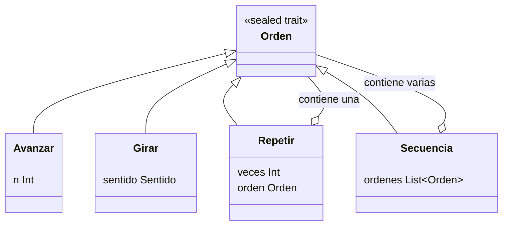

### Sistema de coordenadas y notación

- El robot empieza en `inicial = Estado(0, 0, Norte)`.
- El eje $y$ crece hacia el **Norte** y el eje $x$ crece hacia el **Este**.
- Cada dirección tiene un vector unitario:

$$
\vec d(\text{Norte})=(0,1),\quad
\vec d(\text{Este})=(1,0),\quad
\vec d(\text{Sur})=(0,-1),\quad
\vec d(\text{Oeste})=(-1,0)
$$

- Avanzar $n$ casillas desde $(x,y,d)$ da:

$$\text{Avanzar}(n):\ (x,y,d)\ \longmapsto\ \big(x+n\,d_x,\ y+n\,d_y,\ d\big)$$

  y con $n$ negativo el robot **retrocede**.
- Numerando las direcciones $\text{Norte}=0,\ \text{Este}=1,\ \text{Sur}=2,\ \text{Oeste}=3$, girar es sumar o restar 1 módulo 4:

$$
\text{Girar}(\text{Derecha}):\ d\mapsto (d+1)\bmod 4,\qquad
\text{Girar}(\text{Izquierda}):\ d\mapsto (d-1)\bmod 4
$$

- En los **diagramas**, las direcciones se abrevian **N, E, S, O** (O = Oeste) para que quepan en los nodos. En las **tablas** se escriben completas.
- Una **traza** es la lista de estados por los que pasa el robot: el estado inicial y el estado tras cada orden básica.

---

## 1. Punto 1: `girar`

### Cómo se ejecuta

`girar(d, s)` no es recursiva. Hace un `match` sobre la **pareja** `(d, s)`: el compilador prueba los casos de arriba hacia abajo y devuelve el resultado del primero que coincide. Como hay 4 direcciones y 2 sentidos, hay $4\times 2=8$ combinaciones, y el código tiene un caso para cada una:

| Caso (orden del código) | Pareja `(d, s)` | Resultado |
|---|---|---|
| 1 | `(Norte, Derecha)` | `Este` |
| 2 | `(Norte, Izquierda)` | `Oeste` |
| 3 | `(Oeste, Derecha)` | `Norte` |
| 4 | `(Oeste, Izquierda)` | `Sur` |
| 5 | `(Sur, Izquierda)` | `Este` |
| 6 | `(Sur, Derecha)` | `Oeste` |
| 7 | `(Este, Derecha)` | `Sur` |
| 8 | `(Este, Izquierda)` | `Norte` |

Como los tipos son `sealed`, el compilador avisa si falta alguna combinación.

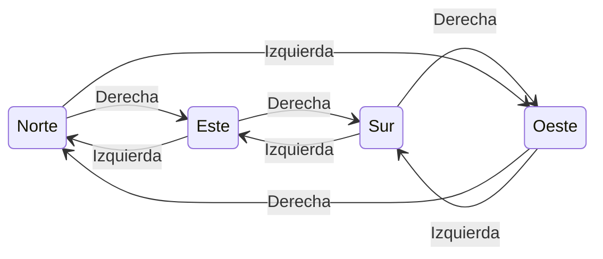

### Traza de direcciones

Como `girar` sólo cambia la dirección (no la posición), aquí se traza la **dirección** del robot.

**Ejemplo 1.** `girar(girar(Este, Derecha), Izquierda)`. Se evalúa primero el argumento interno:

| Paso | Llamada | Caso que coincide | Resultado |
|---|---|---|---|
| 1 | `girar(Este, Derecha)` | 7 | `Sur` |
| 2 | `girar(Sur, Izquierda)` | 5 | `Este` |

Un giro y su contrario se cancelan: se vuelve a `Este`.

**Ejemplo 2.** Cuatro giros a la derecha desde `Norte` (el `foldLeft` de la prueba aplica `girar` cuatro veces):

| Paso | Dirección antes | Giro | Dirección después |
|---|---|---|---|
| 1 | Norte | Derecha | Este |
| 2 | Este | Derecha | Sur |
| 3 | Sur | Derecha | Oeste |
| 4 | Oeste | Derecha | Norte |

**Ejemplo 3.** Cuatro giros a la izquierda desde `Norte`: Norte → Oeste → Sur → Este → Norte. En ambos casos $4\equiv 0 \pmod 4$ y el robot vuelve a mirar al norte.

---

## 2. Punto 2: `ejecutar`

### Cómo se ejecuta

`ejecutar(e, o)` hace un `match` sobre la orden `o`, con un caso por cada alternativa del tipo:

| Orden | Qué hace |
|---|---|
| `Avanzar(n)` | Hace `match` sobre `e.mira` y suma o resta `n` a `x` o `y` según la dirección. Devuelve una **copia** del estado con la coordenada cambiada. |
| `Girar(s)` | Devuelve una copia del estado con `mira = girar(e.mira, s)`. |
| `Repetir(v, orden)` | Si `v <= 0`, devuelve `e` sin cambio. Si no, ejecuta `orden` una vez y luego `Repetir(v - 1, orden)` sobre el estado resultante. |
| `Secuencia(ordenes)` | `ordenes.foldLeft(e)`: ejecuta cada orden de la lista, pasando el estado de una a la siguiente. |

El caso `Repetir` es:

```scala
ejecutar(ejecutar(e, orden), Repetir(veces - 1, orden))
```

Scala evalúa los argumentos de izquierda a derecha, así que **primero** se ejecuta `orden` una vez (argumento interno) y **después** se repite el resto con el estado nuevo. Un `Repetir(v, o)` se desarrolla así:

$$
\texttt{ejecutar}(e,\text{Repetir}(v,o))=
\begin{cases}
e & v\le 0\\
\texttt{ejecutar}\big(\texttt{ejecutar}(e,o),\ \text{Repetir}(v-1,o)\big) & v>0
\end{cases}
$$

Y el `Secuencia` es un pliegue: para $[o_1,\dots,o_k]$ y estado inicial $e_0$,

$$e_i=\texttt{ejecutar}(e_{i-1},\,o_i)\quad (i=1,\dots,k),\qquad \text{resultado}=e_k$$

Como no se usan variables ni ciclos, el estado "avanza" pasándose como argumento o como acumulador del `foldLeft`.

### Ejemplo 1: `Avanzar(3)` desde `inicial`

1. `match` entra al caso `Avanzar(3)`.
2. `e.mira` es `Norte`, así que se suma a `y`: $y=0+3$.

| Paso | Orden | Estado antes | Estado después |
|---|---|---|---|
| 1 | `Avanzar(3)` | (0, 0, Norte) | **(0, 3, Norte)** |

### Ejemplo 2: `Secuencia(List(Avanzar(2), Girar(Derecha), Avanzar(4)))`

El `foldLeft` arranca con el estado inicial y va actualizándolo:

| Paso | Orden | Estado antes | Estado después |
|---|---|---|---|
| 1 | `Avanzar(2)` | (0, 0, Norte) | (0, 2, Norte) |
| 2 | `Girar(Derecha)` | (0, 2, Norte) | (0, 2, Este) |
| 3 | `Avanzar(4)` | (0, 2, Este) | **(4, 2, Este)** |

En el paso 3 el robot mira al Este, así que el avance suma a $x$ y no a $y$.

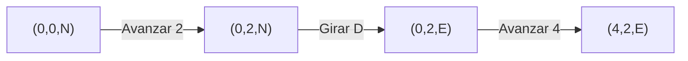

### Ejemplo 3: el cuadrado

`cuadrado = Repetir(4, Secuencia(List(Avanzar(1), Girar(Derecha))))`. Sea $S$ la secuencia interna. El desarrollo de `ejecutar(inicial, cuadrado)` es:

$$
\begin{aligned}
\texttt{ejecutar}(e_0,\text{Repetir}(4,S))
&=\texttt{ejecutar}\big(\texttt{ejecutar}(e_0,S),\ \text{Repetir}(3,S)\big)\\
&=\texttt{ejecutar}\big(\texttt{ejecutar}(e_1,S),\ \text{Repetir}(2,S)\big)\\
&=\texttt{ejecutar}\big(\texttt{ejecutar}(e_2,S),\ \text{Repetir}(1,S)\big)\\
&=\texttt{ejecutar}\big(\texttt{ejecutar}(e_3,S),\ \text{Repetir}(0,S)\big)\\
&=\texttt{ejecutar}(e_4,\text{Repetir}(0,S))=e_4
\end{aligned}
$$

donde $e_i$ es el estado tras la vuelta número $i$. La traza completa, orden básica por orden básica:

| Paso | Vuelta (Repetir pendiente) | Orden básica | Estado antes | Estado después |
|---|---|---|---|---|
| 1 | 1 (quedan 4) | `Avanzar(1)` | (0, 0, Norte) | (0, 1, Norte) |
| 2 | 1 | `Girar(Derecha)` | (0, 1, Norte) | (0, 1, Este) |
| 3 | 2 (quedan 3) | `Avanzar(1)` | (0, 1, Este) | (1, 1, Este) |
| 4 | 2 | `Girar(Derecha)` | (1, 1, Este) | (1, 1, Sur) |
| 5 | 3 (quedan 2) | `Avanzar(1)` | (1, 1, Sur) | (1, 0, Sur) |
| 6 | 3 | `Girar(Derecha)` | (1, 0, Sur) | (1, 0, Oeste) |
| 7 | 4 (queda 1) | `Avanzar(1)` | (1, 0, Oeste) | (0, 0, Oeste) |
| 8 | 4 | `Girar(Derecha)` | (0, 0, Oeste) | **(0, 0, Norte)** |
| fin | `Repetir(0, S)` | caso `veces <= 0` | (0, 0, Norte) | (0, 0, Norte) |

El robot recorre un cuadrado de lado 1 y vuelve exactamente al punto de partida, mirando al norte.

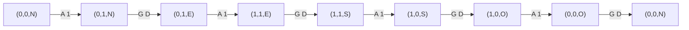

### Cómo se encadenan los llamados en `Repetir`

Para `Repetir(2, Avanzar(1))` desde `inicial`, el argumento interno se evalúa antes de hacer la llamada para repetir el resto:

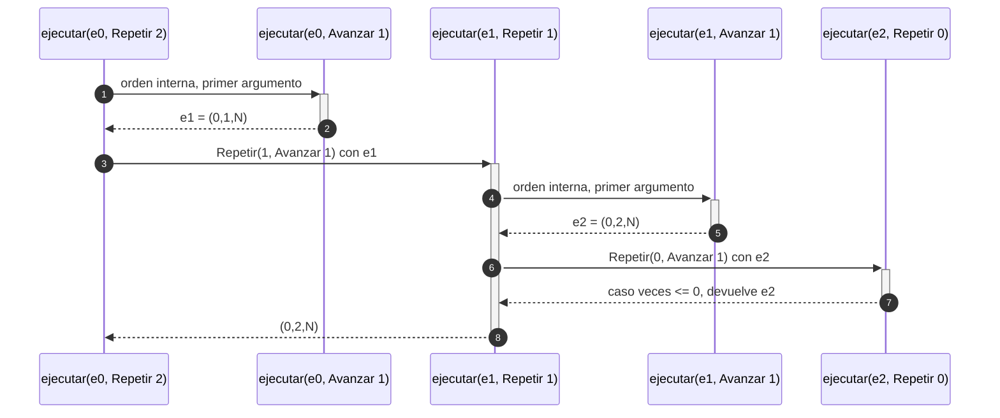

| Llamada | Estado que recibe | Qué hace | Estado que devuelve |
|---|---|---|---|
| `ejecutar(e0, Repetir 2)` | (0, 0, Norte) | `v = 2 > 0`: ejecuta una vez y repite el resto | (0, 2, Norte) |
| `ejecutar(e0, Avanzar 1)` | (0, 0, Norte) | avanza al norte | (0, 1, Norte) |
| `ejecutar(e1, Repetir 1)` | (0, 1, Norte) | `v = 1 > 0`: ejecuta una vez y repite el resto | (0, 2, Norte) |
| `ejecutar(e1, Avanzar 1)` | (0, 1, Norte) | avanza al norte | (0, 2, Norte) |
| `ejecutar(e2, Repetir 0)` | (0, 2, Norte) | `v <= 0`: no hace nada | (0, 2, Norte) |

### Otros casos

| Caso | Qué ocurre | Estado final |
|---|---|---|
| `Avanzar(-2)` desde `inicial` | Mira al Norte: $y=0+(-2)$, retrocede | (0, -2, Norte) |
| `Avanzar(0)` desde (5, 5, Norte) | $y=5+0$, no cambia | (5, 5, Norte) |
| `Repetir(0, Avanzar(5))` | `veces <= 0`, devuelve `e` | (0, 0, Norte) |
| `Repetir(-2, Avanzar(5))` | `veces <= 0`, devuelve `e` | (0, 0, Norte) |
| `Secuencia(Nil)` | `foldLeft` sobre lista vacía devuelve el valor inicial | (0, 0, Norte) |
| `Repetir(1, Avanzar(4))` | Una vuelta y luego `Repetir(0, ...)` | (0, 4, Norte), igual que `Avanzar(4)` |
| `Avanzar(2)` desde (5, 5, Sur) | Mira al Sur: $y=5-2$ | (5, 3, Sur) |
| `Avanzar(2)` desde (5, 5, Oeste) | Mira al Oeste: $x=5-2$ | (3, 5, Oeste) |
| `Avanzar(3)` desde (0, 0, Este) | Mira al Este: $x=0+3$ | (3, 0, Este) |
| `Secuencia(List(Girar(Derecha), Girar(Derecha)))` | Norte → Este → Sur | (0, 0, Sur) |

### Repetición anidada: `Repetir(2, Repetir(3, Avanzar(1)))`

La orden interna `Repetir(3, Avanzar(1))` se ejecuta dos veces; cada una avanza 3 casillas. La traza tiene 6 avances:

| Paso | Repetir exterior | Repetir interior | Estado después |
|---|---|---|---|
| 1 | 1.ª vuelta | 1.ª | (0, 1, Norte) |
| 2 | 1.ª vuelta | 2.ª | (0, 2, Norte) |
| 3 | 1.ª vuelta | 3.ª | (0, 3, Norte) |
| 4 | 2.ª vuelta | 1.ª | (0, 4, Norte) |
| 5 | 2.ª vuelta | 2.ª | (0, 5, Norte) |
| 6 | 2.ª vuelta | 3.ª | **(0, 6, Norte)** |

---

## 3. Punto 3: `cuantasBasicas` y `profundidad`

### Cómo se ejecutan

Ambas funciones recorren el árbol de la orden con un `match` y no mueven al robot. Sus definiciones recursivas son:

$$
\begin{aligned}
B(\text{Avanzar}(n))&=1,\qquad B(\text{Girar}(s))=1\\
B(\text{Repetir}(v,o))&=\begin{cases}0 & v\le 0\\ v\cdot B(o) & v>0\end{cases}\\
B(\text{Secuencia}([o_1,\dots,o_k]))&=\sum_{i=1}^{k} B(o_i)
\end{aligned}
$$

$$
\begin{aligned}
P(\text{Avanzar}(n))&=1,\qquad P(\text{Girar}(s))=1\\
P(\text{Repetir}(v,o))&=1+P(o)\\
P(\text{Secuencia}([\,]))&=1\\
P(\text{Secuencia}([o_1,\dots,o_k]))&=1+\max_i P(o_i)\quad (k\ge 1)
\end{aligned}
$$

donde $B$ es `cuantasBasicas` y $P$ es `profundidad`.

Hay una diferencia: **`profundidad` no mira `veces`** (mide la forma del árbol), mientras que `cuantasBasicas` sí lo usa (cuenta lo que realmente se ejecuta).

### Ejemplo: el cuadrado

`cuantasBasicas` y `profundidad` bajan por el árbol hasta las hojas y luego combinan los valores al subir:

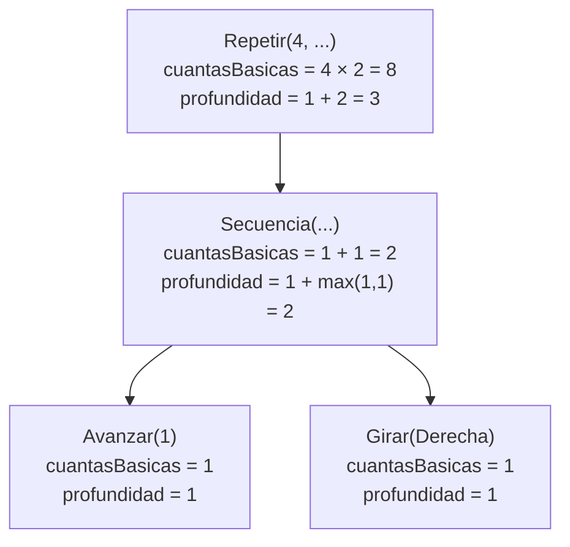

Orden de evaluación de `cuantasBasicas(cuadrado)`:

| Paso | Llamada | Resultado |
|---|---|---|
| 1 | `cuantasBasicas(Repetir(4, S))`, con `veces = 4 > 0` | espera `cuantasBasicas(S)` |
| 2 | `cuantasBasicas(S)`: `S.ordenes.map(cuantasBasicas)` | espera la lista |
| 3 | `cuantasBasicas(Avanzar(1))` | 1 |
| 4 | `cuantasBasicas(Girar(Derecha))` | 1 |
| 5 | `List(1, 1).sum` | 2 |
| 6 | `4 * 2` | **8** |

Para `profundidad(cuadrado)`: las hojas valen 1, `Secuencia` da $1+\max(1,1)=2$ y `Repetir` da $1+2=3$.

**Traza del robot.** Las 8 órdenes básicas que cuenta `cuantasBasicas` son exactamente los 8 pasos de la traza del cuadrado (sección 2, ejemplo 3): cada fila de esa tabla es una orden básica ejecutada. El robot pasa por (0,1,N), (0,1,E), (1,1,E), (1,1,S), (1,0,S), (1,0,O), (0,0,O) y (0,0,N).

### Más ejemplos

| Orden | Cuenta de básicas | Profundidad | Traza del robot desde `inicial` |
|---|---|---|---|
| `Avanzar(3)` | 1 | 1 | (0,0,N) → (0,3,N): 1 paso |
| `Girar(Izquierda)` | 1 | 1 | (0,0,N) → (0,0,O): 1 paso |
| `Secuencia(Avanzar(1), Girar(Derecha))` | $1+1=2$ | $1+\max(1,1)=2$ | (0,1,N) → (0,1,E): 2 pasos |
| `Secuencia(Avanzar(1), Girar(Derecha), Avanzar(2))` | 3 | 2 | (0,1,N), (0,1,E), (2,1,E): 3 pasos |
| `Repetir(3, Avanzar(2))` | $3\cdot 1=3$ | $1+1=2$ | (0,2,N), (0,4,N), (0,6,N): 3 pasos |
| `Repetir(5, Secuencia(Avanzar(2), Girar(Derecha)))` | $5\cdot 2=10$ | $1+2=3$ | 10 pasos |
| `Repetir(2, Repetir(3, Avanzar(1)))` | $2\cdot 3\cdot 1=6$ | $1+1+1=3$ | 6 avances, termina en (0,6,N) |
| `Secuencia(Avanzar(1), cuadrado)` | $1+8=9$ | $1+\max(1,3)=4$ | 9 pasos |
| `Secuencia(Avanzar(1), Repetir(2, Avanzar(1)))` | $1+2=3$ | $1+\max(1,2)=3$ | 3 avances, termina en (0,3,N) |
| `Secuencia(Secuencia(Avanzar(1)))` | 1 | $1+(1+1)=3$ | (0,1,N): 1 paso |
| `Repetir(0, cuadrado)` | **0** | $1+3=4$ | (0,0,N): ningún paso |
| `Repetir(-2, Avanzar(5))` | **0** | 2 | (0,0,N): ningún paso |
| `Secuencia(Nil)` | 0 | **1** | (0,0,N): ningún paso |
| `Repetir(3, Secuencia(Nil))` | $3\cdot 0=0$ | $1+1=2$ | (0,0,N): ningún paso |

En todas las filas con avances, el **número de pasos de la traza coincide con `cuantasBasicas`**; en los casos con `veces <= 0` ambos son cero.

**Trazas completas de las filas que arriba sólo indican el número de pasos** (siempre desde `inicial`):

| Orden | Traza completa (estado tras cada orden básica) | Estado final |
|---|---|---|
| `Repetir(5, Secuencia(Avanzar(2), Girar(Derecha)))` | (0,2,N), (0,2,E), (2,2,E), (2,2,S), (2,0,S), (2,0,O), (0,0,O), (0,0,N), (0,2,N), (0,2,E) | (0, 2, Este) |
| `Secuencia(Avanzar(1), cuadrado)` | (0,1,N), y luego el cuadrado desde allí: (0,2,N), (0,2,E), (1,2,E), (1,2,S), (1,1,S), (1,1,O), (0,1,O), (0,1,N) | (0, 1, Norte) |
| `Secuencia(Secuencia(Avanzar(1)))` | (0,1,N) | (0, 1, Norte) |
| `Repetir(0, cuadrado)` | ningún paso | (0, 0, Norte) |

---

## 4. Punto 4: `componer`, `rutina`, `aplicarA` y `transformar`

### 4.1 `componer`

**Cómo se ejecuta.** `componer(o1, o2)` no ejecuta nada: sólo **construye** la orden `Secuencia(List(o1, o2))`. Ejecutar esa secuencia equivale a ejecutar $o_1$ y, sobre el estado resultante, $o_2$:

$$\texttt{ejecutar}\big(e,\ \texttt{componer}(o_1,o_2)\big)=\texttt{ejecutar}\big(\texttt{ejecutar}(e,o_1),\ o_2\big)$$

**Traza: `componer(Avanzar(2), Girar(Derecha))` desde `inicial`.**

| Paso | Orden | Estado antes | Estado después |
|---|---|---|---|
| 1 | `Avanzar(2)` | (0, 0, Norte) | (0, 2, Norte) |
| 2 | `Girar(Derecha)` | (0, 2, Norte) | **(0, 2, Este)** |

**El orden importa.** `componer(Girar(Derecha), Avanzar(2))` da otro resultado:

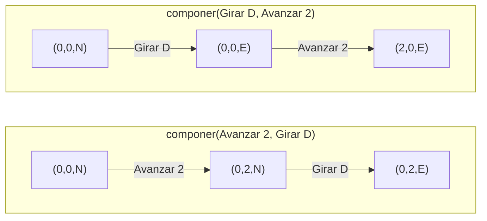

Ambas terminan mirando al Este pero en posiciones distintas: (0, 2) y (2, 0).

**Otros ejemplos:**

| Orden compuesta | Traza desde `inicial` | Estado final |
|---|---|---|
| `componer(Avanzar(2), Avanzar(3))` | (0,2,N), (0,5,N) | (0, 5, Norte) |
| `componer(Girar(Derecha), Avanzar(3))` | (0,0,E), (3,0,E) | (3, 0, Este) |
| `componer(Girar(Derecha), Girar(Derecha))` | (0,0,E), (0,0,S) | (0, 0, Sur) |
| `componer(Secuencia(Nil), Avanzar(2))` | (0,0,N) sin cambio, luego (0,2,N) | (0, 2, Norte) |
| `componer(Secuencia(Avanzar(1)), Secuencia(Avanzar(2)))` | (0,1,N), (0,3,N) | (0, 3, Norte) |

### 4.2 `rutina`

**Cómo se ejecuta.** `rutina` está **currificada**: tiene tres listas de parámetros y su tipo es

$$\texttt{rutina}:\ \text{Int}\to\text{Sentido}\to\text{Int}\to\text{Orden}$$

Cada aplicación parcial devuelve una función. Con la sintaxis `rutina(1)(Derecha) _` se obtiene una función `Int => Orden`:

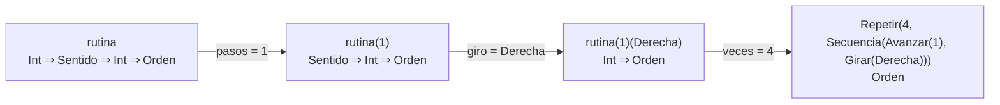

Al recibir los tres valores, `rutina(pasos)(giro)(veces)` construye:

$$\text{Repetir}\big(veces,\ \text{Secuencia}([\text{Avanzar}(pasos),\ \text{Girar}(giro)])\big)$$

Por eso `rutina(1)(Derecha)(4)` es **exactamente** el `cuadrado` del enunciado.

**Traza: `rutina(2)(Izquierda)(1)` desde `inicial`.**

| Paso | Orden | Estado antes | Estado después |
|---|---|---|---|
| 1 | `Avanzar(2)` | (0, 0, Norte) | (0, 2, Norte) |
| 2 | `Girar(Izquierda)` | (0, 2, Norte) | **(0, 2, Oeste)** |

**Traza: `rutina(1)(Izquierda)(4)`** (un cuadrado girando a la izquierda):

| Paso | Orden | Estado antes | Estado después |
|---|---|---|---|
| 1 | `Avanzar(1)` | (0, 0, Norte) | (0, 1, Norte) |
| 2 | `Girar(Izquierda)` | (0, 1, Norte) | (0, 1, Oeste) |
| 3 | `Avanzar(1)` | (0, 1, Oeste) | (-1, 1, Oeste) |
| 4 | `Girar(Izquierda)` | (-1, 1, Oeste) | (-1, 1, Sur) |
| 5 | `Avanzar(1)` | (-1, 1, Sur) | (-1, 0, Sur) |
| 6 | `Girar(Izquierda)` | (-1, 0, Sur) | (-1, 0, Este) |
| 7 | `Avanzar(1)` | (-1, 0, Este) | (0, 0, Este) |
| 8 | `Girar(Izquierda)` | (0, 0, Este) | **(0, 0, Norte)** |

**Otros ejemplos:**

| Rutina | Traza desde `inicial` | Estado final |
|---|---|---|
| `rutina(1)(Derecha)(4)` | el cuadrado de la sección 2 | (0, 0, Norte) |
| `rutina(1)(Derecha)(0)` | `Repetir(0, ...)` no ejecuta nada | (0, 0, Norte) |
| `rutina(-2)(Derecha)(1)` | `Avanzar(-2)`: (0,-2,N); `Girar(Derecha)`: (0,-2,E) | (0, -2, Este) |
| `rutina(2)(Derecha)(3)` | (0,2,N), (0,2,E), (2,2,E), (2,2,S), (2,0,S), (2,0,O) | (2, 0, Oeste) |

### 4.3 `aplicarA`

**Cómo se ejecuta.** `aplicarA(estados, o)` es `estados.map(q => ejecutar(q, o))`: aplica la **misma orden** a cada estado de la lista, de forma independiente, y devuelve la lista de resultados en el mismo orden. La lista original no se modifica y el resultado tiene la misma longitud.

**Traza: `aplicarA(List(inicial, Estado(5,5,Sur)), Avanzar(2))`.**

| Estado de entrada | Orden | Estado de salida |
|---|---|---|
| (0, 0, Norte) | `Avanzar(2)`, suma a $y$ | (0, 2, Norte) |
| (5, 5, Sur) | `Avanzar(2)`, resta a $y$ | (5, 3, Sur) |

Resultado: `List(Estado(0,2,Norte), Estado(5,3,Sur))`.

**Traza con una orden compuesta:** `Secuencia(List(Avanzar(1), Girar(Derecha), Avanzar(1)))` sobre `List(Estado(0,0,Norte), Estado(0,0,Sur))`:

| Paso | Orden | Robot 1 (empieza al Norte) | Robot 2 (empieza al Sur) |
|---|---|---|---|
| 0 | estado inicial | (0, 0, Norte) | (0, 0, Sur) |
| 1 | `Avanzar(1)` | (0, 1, Norte) | (0, -1, Sur) |
| 2 | `Girar(Derecha)` | (0, 1, Este) | (0, -1, Oeste) |
| 3 | `Avanzar(1)` | **(1, 1, Este)** | **(-1, -1, Oeste)** |

**Con `Repetir`:** `Repetir(2, Avanzar(1))` sobre `List(Estado(0,0,Norte), Estado(0,0,Este))` da `List(Estado(0,2,Norte), Estado(2,0,Este))`: cada robot avanza dos casillas en su propia dirección.

**Casos límite:** sobre `Nil` devuelve `Nil` (no hay elementos que transformar); sobre `List(inicial)` con `Girar(Derecha)` devuelve `List(Estado(0,0,Este))`.

### 4.4 `transformar`

**Cómo se ejecuta.** `transformar(o, f)` reemplaza cada orden **básica** por `f(orden)` y conserva la estructura de las compuestas. La función `f` tiene tipo `Orden => Orden` (es una función de orden superior: recibe una función como argumento):

| Orden | Qué hace |
|---|---|
| `Avanzar(n)` | Devuelve `f(Avanzar(n))` |
| `Girar(s)` | Devuelve `f(Girar(s))` |
| `Repetir(v, o)` | **No** aplica `f` a `Repetir`: devuelve `Repetir(v, transformar(o, f))` |
| `Secuencia(os)` | Devuelve `Secuencia(os.map(q => transformar(q, f)))` |

**Ejemplo: duplicar los avances del cuadrado.** Con `f = { case Avanzar(n) => Avanzar(2*n); case otra => otra }`:

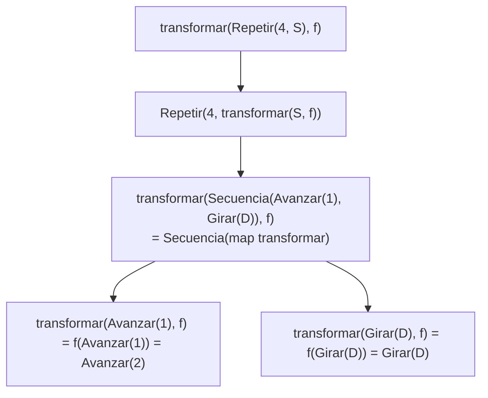

El resultado es `Repetir(4, Secuencia(List(Avanzar(2), Girar(Derecha))))`. **Traza del robot** al ejecutarlo desde `inicial` (un cuadrado de lado 2):

| Paso | Orden | Estado antes | Estado después |
|---|---|---|---|
| 1 | `Avanzar(2)` | (0, 0, Norte) | (0, 2, Norte) |
| 2 | `Girar(Derecha)` | (0, 2, Norte) | (0, 2, Este) |
| 3 | `Avanzar(2)` | (0, 2, Este) | (2, 2, Este) |
| 4 | `Girar(Derecha)` | (2, 2, Este) | (2, 2, Sur) |
| 5 | `Avanzar(2)` | (2, 2, Sur) | (2, 0, Sur) |
| 6 | `Girar(Derecha)` | (2, 0, Sur) | (2, 0, Oeste) |
| 7 | `Avanzar(2)` | (2, 0, Oeste) | (0, 0, Oeste) |
| 8 | `Girar(Derecha)` | (0, 0, Oeste) | **(0, 0, Norte)** |

**Ejemplo: invertir el sentido de los giros** (`f` cambia `Girar(Derecha)` por `Girar(Izquierda)` y viceversa). `transformar(cuadrado, invertir)` produce `Repetir(4, Secuencia(List(Avanzar(1), Girar(Izquierda))))`, que es lo mismo que `rutina(1)(Izquierda)(4)`; su traza es la del cuadrado a la izquierda de la sección 4.2.

**Otros ejemplos:**

| Llamada | Resultado |
|---|---|
| `transformar(cuadrado, identidad)` | `cuadrado`, sin cambios |
| `transformar(Girar(Derecha), invertir)` | `Girar(Izquierda)` |
| `transformar(Secuencia(Avanzar(1), Avanzar(2)), n => n+1)` | `Secuencia(Avanzar(2), Avanzar(3))` |
| `transformar(Repetir(2, Avanzar(1)), n => n*10)` | `Repetir(2, Avanzar(10))`: `f` se aplica a la orden interna, no a `Repetir` |
| `transformar(Secuencia(Secuencia(Avanzar(1)), Avanzar(2)), n => n*2)` | `Secuencia(Secuencia(Avanzar(2)), Avanzar(4))`: conserva el anidamiento |
| `transformar(Avanzar(5), Avanzar(_) => Girar(Derecha))` | `Girar(Derecha)`: `f` puede cambiar el tipo de la orden |

**Efecto sobre el robot** (traza desde `inicial`, orden original frente a orden transformada):

| Ejemplo | Traza de la original | Traza de la transformada |
|---|---|---|
| `Girar(Derecha)` con `invertir` | (0,0,E) | (0,0,O) |
| `Secuencia(Avanzar(1), Avanzar(2))` con `n => n+1` | (0,1,N), (0,3,N) | (0,2,N), (0,5,N) |
| `Repetir(2, Avanzar(1))` con `n => n*10` | (0,1,N), (0,2,N) | (0,10,N), (0,20,N) |
| `Secuencia(Secuencia(Avanzar(1)), Avanzar(2))` con `n => n*2` | (0,1,N), (0,3,N) | (0,2,N), (0,6,N) |
| `Avanzar(5)` con `Avanzar(_) => Girar(Derecha)` | (0,5,N) | (0,0,E) |

---

## 5. Punto 5: `simplificar`

### Las reglas

`simplificar` aplica reglas que reducen una orden sin cambiar su efecto. Numeradas según los comentarios del código (conviene verificar la numeración con la del enunciado):

| Regla | Antes | Después |
|---|---|---|
| R1 | `Repetir(v, o)` con $v\le 0$ | `Secuencia(Nil)` |
| R2 | `Avanzar(a), Avanzar(b)` contiguos en una secuencia | `Avanzar(a+b)` |
| R3 | `Repetir(1, o)` | `o` |
| R4 | `Secuencia(List(o))` | `o` |
| R5 | En una secuencia: `Avanzar(0)`, `Secuencia(Nil)` y `Repetir(v≤0, _)` | se eliminan |

### Cómo se ejecuta

`simplificar` está formada por cuatro funciones internas:

| Función interna | Qué hace |
|---|---|
| `esVacia(o)` | Dice si `o` no hace nada: `Secuencia(Nil)`, `Avanzar(0)` o `Repetir(v≤0, _)` son vacías; cualquier otra no. |
| `auxFusionAvanzar(lista)` | Recorre la lista y reemplaza dos `Avanzar` seguidos por uno con la suma, repitiendo hasta que no haya pares. |
| `auxSimplicarUnaVez(o)` | Una **pasada** de simplificación: baja por el árbol simplificando las órdenes internas y aplica R1 a R5. |
| `auxPuntoFijo(actual)` | Repite `auxSimplicarUnaVez` hasta que el resultado deje de cambiar (`next == actual`). |

La pasada sobre una `Secuencia` hace, en este orden: (1) simplifica cada orden interna, (2) quita las vacías (R5), (3) fusiona avances contiguos (R2), (4) si queda una sola orden la devuelve (R4), si no queda ninguna devuelve `Secuencia(Nil)`, y si quedan varias, `Secuencia(varias)`.

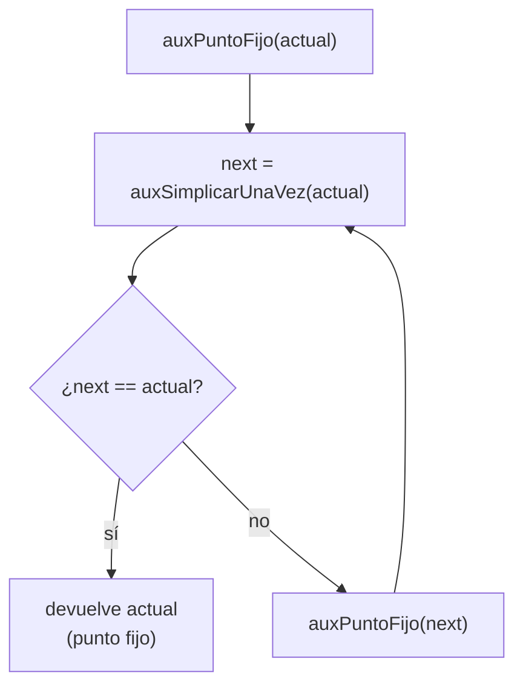

Se necesita el punto fijo porque una pasada puede dejar nuevas oportunidades: por ejemplo, la fusión puede producir `Avanzar(0)`, que sólo se elimina en la pasada siguiente.

### Traza de `auxFusionAvanzar`

Sobre `List(Avanzar(1), Avanzar(2), Girar(Derecha), Avanzar(3))`:

| Paso | Lista que recibe | Caso | Qué hace |
|---|---|---|---|
| 1 | `A1, A2, G, A3` | `Avanzar, Avanzar` | Fusiona: llama con `A3', G, A3` (donde `A3'` es `Avanzar(1+2)`) |
| 2 | `A3', G, A3` | cualquier otra | Deja `A3'` y sigue con `G, A3` |
| 3 | `G, A3` | cualquier otra | Deja `G` y sigue con `A3` |
| 4 | `A3` | cualquier otra | Deja `A3` y sigue con `Nil` |
| 5 | `Nil` | `Nil` | Devuelve `Nil` |

Resultado: `List(Avanzar(3), Girar(Derecha), Avanzar(3))`. La fusión se detiene al toparse con `Girar`: sólo se juntan avances **contiguos**.

### Ejemplo 1: `Secuencia(List(Avanzar(2), Avanzar(3)))`

| Pasada | Entrada | Resultado de la pasada |
|---|---|---|
| 1 | `Secuencia(Avanzar(2), Avanzar(3))` | las dos se simplifican a sí mismas; ninguna es vacía; se fusionan en `List(Avanzar(5))`; queda una sola (R4) → `Avanzar(5)` |
| 2 | `Avanzar(5)` | `Avanzar(5)`: igual a la entrada → **fin** |

**Resultado:** `Avanzar(5)`.

**Traza del robot (original y simplificada):**

| Paso | Original: orden | Estado | Simplificada: orden | Estado |
|---|---|---|---|---|
| 0 | inicio | (0, 0, Norte) | inicio | (0, 0, Norte) |
| 1 | `Avanzar(2)` | (0, 2, Norte) | `Avanzar(5)` | **(0, 5, Norte)** |
| 2 | `Avanzar(3)` | **(0, 5, Norte)** | — | — |

### Ejemplo 2: `Secuencia(List(Avanzar(2), Avanzar(-2)))` (necesita 3 pasadas)

| Pasada | Entrada | Qué ocurre | Resultado |
|---|---|---|---|
| 1 | `Secuencia(A2, A-2)` | Ninguna es vacía. Se fusionan en `Avanzar(2 + (-2)) = Avanzar(0)`. Queda una sola (R4). | `Avanzar(0)` |
| 2 | `Avanzar(0)` | Caso `Avanzar(0)` de la pasada | `Secuencia(Nil)` |
| 3 | `Secuencia(Nil)` | `map` y `filterNot` sobre lista vacía → `Nil` → `Secuencia(Nil)`. Igual a la entrada. | **fin** |

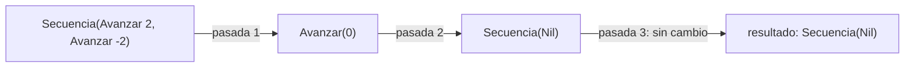

**Traza del robot:**

| Paso | Original: orden | Estado | Simplificada: orden | Estado |
|---|---|---|---|---|
| 0 | inicio | (0, 0, Norte) | inicio | (0, 0, Norte) |
| 1 | `Avanzar(2)` | (0, 2, Norte) | `Secuencia(Nil)` | **(0, 0, Norte)** |
| 2 | `Avanzar(-2)` | **(0, 0, Norte)** | — | — |

### Ejemplo 3: avances contiguos y separados

`Secuencia(List(Avanzar(1), Avanzar(2), Girar(Derecha), Avanzar(3)))` se simplifica en una pasada (la fusión es la del apartado anterior) a `Secuencia(List(Avanzar(3), Girar(Derecha), Avanzar(3)))`, y la segunda pasada no cambia nada.

| Paso | Original: orden | Estado | Simplificada: orden | Estado |
|---|---|---|---|---|
| 0 | inicio | (0, 0, Norte) | inicio | (0, 0, Norte) |
| 1 | `Avanzar(1)` | (0, 1, Norte) | `Avanzar(3)` | (0, 3, Norte) |
| 2 | `Avanzar(2)` | (0, 3, Norte) | `Girar(Derecha)` | (0, 3, Este) |
| 3 | `Girar(Derecha)` | (0, 3, Este) | `Avanzar(3)` | **(3, 3, Este)** |
| 4 | `Avanzar(3)` | **(3, 3, Este)** | — | — |

### Ejemplo 4: `Repetir` (R1 y R3)

| Orden | Pasada 1 | Pasada 2 | Resultado |
|---|---|---|---|
| `Repetir(1, Avanzar(4))` | R3: `veces == 1` → `Avanzar(4)` | sin cambio | `Avanzar(4)` |
| `Repetir(0, Avanzar(9))` | R1: `veces <= 0` → `Secuencia(Nil)` | sin cambio | `Secuencia(Nil)` |
| `Repetir(3, Repetir(1, Avanzar(2)))` | interna: R3 → `Avanzar(2)`; externa: `veces = 3` → `Repetir(3, Avanzar(2))` | sin cambio | `Repetir(3, Avanzar(2))` |
| `Repetir(3, Secuencia(Avanzar(1), Avanzar(2)))` | interna: fusión → `Avanzar(3)`; externa → `Repetir(3, Avanzar(3))` | sin cambio | `Repetir(3, Avanzar(3))` |
| `Repetir(1, Secuencia(Avanzar(1), Avanzar(2)))` | interna → `Avanzar(3)`; R3 → `Avanzar(3)` | sin cambio | `Avanzar(3)` |
| `Secuencia(Avanzar(0), Avanzar(4))` | `Avanzar(0)` → `Secuencia(Nil)`, R5 la elimina; queda `List(Avanzar(4))`, R4 → `Avanzar(4)` | sin cambio | `Avanzar(4)` |
| `Secuencia(Avanzar(0), Girar(Derecha), Repetir(0, Avanzar(9)))` | R5 elimina la 1.ª y la 3.ª; queda `Girar(Derecha)` | sin cambio | `Girar(Derecha)` |

**Trazas de posición de los ejemplos de la tabla anterior** (desde `inicial`; tras cada orden básica):

| Orden original | Traza de la original | Orden simplificada | Traza de la simplificada | Estado final (igual en ambas) |
|---|---|---|---|---|
| `Repetir(1, Avanzar(4))` | (0,4,N) | `Avanzar(4)` | (0,4,N) | (0, 4, Norte) |
| `Repetir(0, Avanzar(9))` | sin movimiento | `Secuencia(Nil)` | sin movimiento | (0, 0, Norte) |
| `Repetir(3, Secuencia(Avanzar(1), Avanzar(2)))` | (0,1,N), (0,3,N), (0,4,N), (0,6,N), (0,7,N), (0,9,N) | `Repetir(3, Avanzar(3))` | (0,3,N), (0,6,N), (0,9,N) | (0, 9, Norte) |
| `Repetir(1, Secuencia(Avanzar(1), Avanzar(2)))` | (0,1,N), (0,3,N) | `Avanzar(3)` | (0,3,N) | (0, 3, Norte) |
| `Secuencia(Avanzar(0), Avanzar(4))` | (0,0,N), (0,4,N) | `Avanzar(4)` | (0,4,N) | (0, 4, Norte) |
| `Secuencia(Avanzar(0), Girar(Derecha), Repetir(0, Avanzar(9)))` | (0,0,N), (0,0,E), sin cambio | `Girar(Derecha)` | (0,0,E) | (0, 0, Este) |

**Traza del robot para `Repetir(3, Repetir(1, Avanzar(2)))` y su simplificada `Repetir(3, Avanzar(2))`** (ambas dan la misma traza):

| Paso | Estado después |
|---|---|
| 1 | (0, 2, Norte) |
| 2 | (0, 4, Norte) |
| 3 | **(0, 6, Norte)** |

### Ejemplo 5: la equivalencia sobre distintos estados

Orden: $o=\text{Repetir}\big(3,\ \text{Secuencia}([\text{Repetir}(1,\text{Avanzar}(2)),\ \text{Girar}(\text{Izquierda})])\big)$.

La pasada 1 simplifica la interna `Repetir(1, Avanzar(2))` a `Avanzar(2)` y deja `Repetir(3, Secuencia(Avanzar(2), Girar(Izquierda)))`; la pasada 2 no cambia nada. Se ejecutan **ambas** desde `inicial`:

| Paso | Orden básica | Estado (original) | Estado (simplificada) |
|---|---|---|---|
| 0 | inicio | (0, 0, Norte) | (0, 0, Norte) |
| 1 | `Avanzar(2)` | (0, 2, Norte) | (0, 2, Norte) |
| 2 | `Girar(Izquierda)` | (0, 2, Oeste) | (0, 2, Oeste) |
| 3 | `Avanzar(2)` | (-2, 2, Oeste) | (-2, 2, Oeste) |
| 4 | `Girar(Izquierda)` | (-2, 2, Sur) | (-2, 2, Sur) |
| 5 | `Avanzar(2)` | (-2, 0, Sur) | (-2, 0, Sur) |
| 6 | `Girar(Izquierda)` | **(-2, 0, Este)** | **(-2, 0, Este)** |

Para cualquier orden $o$ y cualquier estado $e$ debe cumplirse:

$$\texttt{ejecutar}\big(e,\ o\big)=\texttt{ejecutar}\big(e,\ \texttt{simplificar}(o)\big)$$

La demostración regla por regla va en el informe de corrección. Aquí se verifica en los ejemplos: en los que muestran traza (ejemplos 1, 2, 3, 4 y 5), la orden original y la simplificada terminan en el **mismo estado**.

---